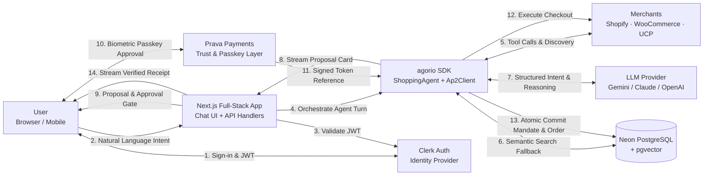

# Autonomous Commerce Agent — System Architecture

**Status:** proposed canonical design  
**Scope:** single-tenant autonomous shopping agent application built on `@agorio/sdk`, Next.js 14+ full-stack runtime, Neon serverless PostgreSQL, Prava payments & trust layer  
**Supersedes for implementation decisions:** earlier exploratory design notes in PROJECT_DOCS.md and preliminary Python-only drafts

## 1. Overview

This application is an Autonomous Commerce Agent (ACA)—an end-to-end conversational operating system for autonomous online commerce. A user expresses a shopping intent in natural language (e.g., flight booking, electronics purchase, grocery reorder); the agent autonomously queries connected merchants, evaluates candidate items against hard constraints and user preferences, proposes a verified option, and—upon biometric human-in-the-loop passkey confirmation—executes checkout autonomously using Prava and the Agent Payments Protocol (AP2). The system guarantees zero card data liability: neither raw card numbers, CVVs, nor permanent credentials ever touch the agent or application server.

The chosen architecture is a **unified TypeScript modular application built directly on top of `@agorio/sdk`**:

- **`@agorio/sdk` Core Engine [Implemented]:** The open-source agentic commerce toolkit provides the `ShoppingAgent` multi-turn reasoning engine, universal protocol clients (Universal Commerce Protocol `UcpClient`, Agentic Commerce Protocol `AcpClient`, Model Context Protocol `McpClient`), merchant adapters (Shopify, WooCommerce, BigCommerce), and governance plugins (spending controls, approval workflows, audit trails);
- **Next.js Full-Stack Application [Planned]:** One TypeScript codebase renders the responsive chat interface, streaming proposal cards, Prava passkey biometric modal, order history, and wallet settings, while hosting server-side route handlers for session orchestration and agent execution;
- **Prava Payments & AP2 Layer [Implemented SDK / Planned Live Bridge]:** Leverages `agorio`'s native `Ap2Client` (Agent Payments Protocol from FIDO Alliance) integrated with Prava to convert user biometric passkey approvals into scoped, single-use, time-boxed payment tokens;
- **Neon Serverless PostgreSQL (with pgvector) [Planned]:** Serves as the single relational and semantic source of truth for user profiles, persistent agent sessions, mandates, transactions, append-only audit records, and cached product embeddings;
- **Clerk Authentication [Planned]:** Manages user identity, JWT issuance, and session authentication, strictly decoupled from payment approval.

This system deliberately avoids distributed microservices, message queues, and polyglot runtimes. By consolidating on TypeScript and leveraging `agorio`'s in-process client tools, intent parsing, candidate evaluation, mandate creation, and checkout execution occur inside a single coherent runtime. At the target scale of 1,000 registered users and 100 concurrent agent sessions, splitting these concerns across disparate network services would introduce latency, partial failure modes, and operational overhead without adding business value.

## 2. Requirements

### Functional requirements

| Area | Required function |
|---|---|
| Identity | Users sign in via Clerk (OAuth / email magic link); backend verifies JWTs via JWKS without storing local passwords. |
| Wallet Controls | Users set per-merchant spend limits and a global 24-hour daily spend cap; enforced by `@agorio/plugin-spending-controls` and database constraints. |
| Intent Extraction | User submits natural-language shopping requests; `ShoppingAgent` extracts structured goals (category, item specifications, budget, delivery constraints). |
| Discovery | Agent queries live merchants using UCP, ACP, and MCP connectors, falling back to cached `pgvector` product embeddings. |
| Decision Engine | Agent applies hard filtering (budget cap, stock availability) and ranks candidates against user preferences with a clear rationale summary. |
| Biometric Gate | System requires explicit in-chat user confirmation and a biometric passkey (Touch ID / Face ID) via Prava before any financial commitment is made. |
| Mandate Lifecycle | `Ap2Client` generates scoped, time-boxed mandates (`merchantId` + `amount` + `expiresAt` ≤ 10 mins); Prava issues a single-use payment token. |
| Autonomous Checkout | Agent consumes the single-use token against merchant checkout endpoints (Shopify, WooCommerce, BigCommerce, or UCP payment handlers) and captures the order confirmation. |
| Reporting | Agent finalizes the database transaction, links the merchant order ID, and streams the verified receipt summary to the user. |
| Order History | User can browse paginated past transactions, receipts, and order statuses. |
| Audit Trail | Every reasoning step, tool call, mandate state change, and payment execution is recorded in an append-only ledger for complete transparency. |

### Non-functional requirements

| Requirement | Target / decision |
|---|---|
| Correctness | Exactly one transaction per mandate. Mandate consumption and transaction insertion execute in a single atomic database transaction (`transactions.mandate_id UNIQUE`). |
| Scale | Sized for 1,000 registered users, 100 concurrent active agent sessions, and short burst checkout peaks (≤ 20 checkouts/minute). |
| Latency | Discovery and decision proposal stream within 3–5 seconds under warm LLM conditions; passkey approval is user-paced; checkout is merchant-paced. |
| Availability | 99% monthly availability for web and API; external dependencies (Prava, LLM provider, merchants) fail gracefully with clear error boundaries. |
| Durability | Transaction records and audit trails are append-only and never deleted; managed point-in-time recovery via Neon PostgreSQL. |
| Security | Zero raw card data. Strict mandate scoping (single merchant, exact price, ≤ 10 min window). WebAuthn/FIDO passkey human-in-the-loop gate. Server-side JWT validation and PostgreSQL Row-Level Security (RLS). |
| Cost | Zero-cost local development and lean cloud hosting (< $30/month) leveraging Neon Serverless (scale-to-zero), Vercel Hobby, and Gemini / Groq free-tier LLM quotas. |

### Explicitly out of scope for v1

- Fully autonomous spending without explicit human passkey approval.
- Multi-merchant split-cart payments in a single mandate transaction.
- Support for merchants lacking programmatic UCP, ACP, MCP, or modern e-commerce checkout APIs.
- Native mobile applications (iOS/Android native builds); responsive web application only.
- Complex multi-agent background bidding swarms or subscription management.
- Direct storage or processing of raw Primary Account Numbers (PANs) or cardholder data.

## 3. Sizing assumptions

The operational workload is bounded by conversational cadence, human approval latency, and external API rate limits:

| Scenario | Approximate load | Consequence |
|---|---:|---|
| 100 users browse order history concurrently | 20–40 read req/s | Standard indexed queries in Neon PostgreSQL handle this comfortably under 10ms. |
| 100 concurrent agent sessions in reasoning loop | 50–100 LLM calls in flight | LLM provider concurrency and rate limits dominate; handled via token-bucket backoff in `agorio` adapters. |
| 50 users trigger passkey mandates in a 10-minute burst | ~0.1 mandates/s | Prava and AP2 client handle this with negligible server compute; mandates serialize per session. |
| Peak checkout burst: 20 completed purchases in 1 minute | ~0.33 checkouts/s | Single Node.js serverless/container instance handles this; merchant checkout API latency is the only bottleneck. |
| 50,000 catalog product embeddings | ~150 MB storage in pgvector | Easily stored within Neon's free/starter storage tier; indexed via IVFFlat / HNSW. |
| 1,000 transactions/year with full audit logs | ~5 MB storage/year | Negligible database footprint; audit trail can remain online permanently without archiving. |

The primary bottleneck is external LLM and merchant API response latency, not local server compute or database throughput. A single Next.js full-stack instance backed by serverless PostgreSQL handles this workload without distributed queues.

## 4. Technology selection

| Concern | Selected technology/pattern | Why this is the smallest correct choice |
|---|---|---|
| Core Commerce SDK | `@agorio/sdk` (TypeScript) [Implemented] | Native open-source toolkit providing `ShoppingAgent`, `Ap2Client`, `UcpClient`, `AcpClient`, `McpClient`, and merchant adapters. Eliminates reinventing commerce protocols. |
| Full-Stack App | Next.js 14+ (App Router + TypeScript) [Planned] | Unified frontend UI (chat, proposal cards, passkey modal) and backend API (Server Actions, Route Handlers, SSE streaming) in one language. |
| Agent Engine | `ShoppingAgent` with `@agorio` Plugins [Implemented SDK] | Replaces the need for a separate Python LangGraph service. Provides conversational tool use, spending controls, approval workflows, and audit logging. |
| Payments & Trust | Prava SDK + `Ap2Client` (FIDO WebAuthn) [Implemented SDK / Planned Live Bridge] | Implements the FIDO Alliance Agent Payments Protocol. Turns biometric passkey confirmation into single-use tokens; leaves card liability with Prava. |
| LLM Provider | Google Gemini API (via `GeminiAdapter`) / Claude (via `ClaudeAdapter`) [Implemented SDK] | `agorio` includes pluggable adapters; Gemini 1.5/2.0 Flash provides fast structured outputs and generous free/low-cost tiers. |
| Primary Database | Neon Serverless PostgreSQL with `pgvector` [Planned] | Provides ACID guarantees for mandate and transaction consistency, serverless scale-to-zero, and integrated semantic vector search in one database. |
| Database Access | Drizzle ORM (TypeScript) + Migrations [Planned] | Type-safe SQL query generation, zero runtime overhead, seamless support for PostgreSQL transactions and `pgvector` extensions. |
| Authentication | Clerk Auth [Planned] | Offloads user identity, OAuth providers, and JWT management. Public JWKS verification decouples identity from payment approval. |
| Merchant Connectors | Shopify, WooCommerce, BigCommerce Adapters + UCP [Implemented SDK] | Native connectors included in `agorio` allow immediate integration with real merchants and mock test fixtures. |

### Rejected alternatives

| Alternative | Why not now | Reconsider when |
|---|---|---|
| Python / FastAPI + LangGraph backend | Creates a dual-language boundary (TypeScript frontend + Python backend), requiring duplicate models and RPC coordination, when `agorio` already provides a complete TypeScript shopping agent. | Python-exclusive ML models or specialized LangGraph checkpointing graphs are strictly required. |
| Pinecone / Dedicated Vector DB | Adds an extra managed service account, billing tier ($70+/mo), and network hop when Neon's `pgvector` handles 50,000 catalog items with sub-10ms latency. | Product catalog exceeds millions of embeddings requiring specialized distributed vector indexing. |
| Redis / Celery / BullMQ Job Queue | In-process asynchronous execution and SSE streaming within Next.js route handlers handle conversational turns cleanly at the target scale. | Background jobs exceed serverless execution timeouts (e.g. long-running batch procurement across hundreds of stores). |
| Microservices (Auth, Payment, Discovery) | Splitting the agent commerce loop into independent microservices introduces distributed transaction complexity, network failure modes, and operational bloat. | Independent engineering teams require autonomous deployment lifecycles or separate compliance perimeters. |

## 5. High-level architecture

### Component responsibilities

| Component | Status | Owns | Does not own |
|---|---|---|---|
| Next.js Frontend | Planned | Chat UI, streaming message rendering, candidate proposal cards, Prava passkey modal trigger, wallet & order history dashboards. | Agent reasoning logic, payment token issuance, direct database access. |
| Next.js Route Handlers / API | Planned | Clerk JWT validation, session context management, SSE stream connection, database transactions via Drizzle ORM. | Client-side UI rendering, LLM inference logic. |
| `ShoppingAgent` (`agorio`) | Implemented | Conversational state machine, prompt engineering, tool calling, candidate constraint filtering, cart assembly, checkout execution. | User credential management, persistent database connection pool. |
| `Ap2Client` (`agorio`) | Implemented | AP2 mandate lifecycle (`IntentMandate` → `CartMandate` → `SignedMandate`), WebAuthn signature integration, refund mandates. | Card acquiring, PCI compliance vaulting (delegated to Prava). |
| Governance Plugins (`agorio`) | Implemented | Daily and per-transaction spend limit verification, human approval threshold gates, structured audit event emitting. | User identity authentication. |
| Merchant Connectors (`agorio`) | Implemented | UCP discovery, ACP checkout, Shopify/Woo/BigCommerce API adapters, MockMerchant fixture. | Price policy decisions, payment token issuance. |
| Prava Payments & Trust | External | Biometric passkey challenge orchestration, cardholder tokenization, single-use token issuance. | Conversational intent parsing, merchant product catalog. |
| Clerk Auth | External | User registration, social OAuth, session JWT lifecycle. | Payment approval, spend limit policy enforcement. |
| Neon PostgreSQL | Planned | ACID relational persistence for users, sessions, mandates, transactions, audit logs; pgvector product catalog index. | Token generation, LLM reasoning. |

### Deployment topology

The entire production application deploys cleanly on modern serverless cloud infrastructure:
- **Application Layer:** Next.js deployed on **Vercel** (or as a lightweight container on **Render / Fly.io**). Routes handle both React Server Components and streaming edge/Node.js API endpoints.
- **Persistence Layer:** **Neon Serverless PostgreSQL** connected over secure TLS with pooled connections (`DATABASE_URL`). Connection credentials remain strictly within Vercel/Fly environment variables.
- **External Network Boundaries:** All interactions with Clerk, Prava, Google Gemini / Anthropic, and external merchant APIs occur over outbound HTTPS/TLS connections. Zero public database ports are exposed.
- **Single Source of Truth:** Neon holds all state. If the application server restarts or scales out, session recovery is achieved by reading active session state and audit records from PostgreSQL.

## 6. Module boundaries

The application repository is organized as a unified monorepo or modular fullstack codebase:

| Module | Location | Status | Owns |
|---|---|---|---|
| `@agorio/sdk` | `src/` | Implemented | Core commerce agent, protocol clients (UCP, ACP, MCP), AP2 client, merchant adapters, LLM adapters. |
| `@agorio/plugins` | `plugins/` | Implemented | Spending controls, approval workflow, audit trail, agent identity attestation, procurement. |
| `Web UI` | `apps/web/components/` | Planned | React components: `ChatBox`, `ProposalCard`, `PasskeyModal`, `ReceiptCard`, `WalletControls`. |
| `API Handlers` | `apps/web/app/api/` | Planned | REST & SSE endpoints: `/api/sessions`, `/api/sessions/[id]/messages`, `/api/mandates`, `/api/transactions`. |
| `Auth Bridge` | `apps/web/lib/auth/` | Planned | Clerk middleware, JWT verification via JWKS, request user context binding. |
| `Database Layer` | `apps/web/lib/db/` | Planned | Drizzle ORM schema, migrations, connection pool, transactional repositories for mandates and transactions. |
| `Prava Bridge` | `apps/web/lib/prava/` | Planned | Adapter binding Prava WebAuthn passkey SDK with `agorio`'s `Ap2Client.sign()`. |
| `Catalog Vector` | `apps/web/lib/catalog/` | Planned | Product embedding generation (Gemini embeddings) and `pgvector` similarity search fallback. |

Modules communicate in-process via TypeScript function calls and dependency injection. Database modifications on mandates and transactions share an explicit database transaction to preserve consistency.

## 7. Data model

The relational database schema enforces the financial integrity of the autonomous commerce loop. All timestamps are UTC using `timestamptz`.

~~~sql
CREATE EXTENSION IF NOT EXISTS "uuid-ossp";
CREATE EXTENSION IF NOT EXISTS "vector";

CREATE TYPE mandate_status AS ENUM ('pending', 'approved', 'expired', 'consumed', 'revoked');
CREATE TYPE transaction_status AS ENUM ('pending', 'completed', 'failed', 'refunded');
CREATE TYPE session_status AS ENUM ('active', 'completed', 'abandoned');

CREATE TABLE users (
  id uuid PRIMARY KEY DEFAULT gen_random_uuid(),
  clerk_user_id text NOT NULL UNIQUE,
  email text NOT NULL UNIQUE,
  display_name text NOT NULL,
  prava_account_id text UNIQUE,
  daily_spend_limit_cents integer NOT NULL DEFAULT 500000, -- Default ₹5,000.00
  created_at timestamptz NOT NULL DEFAULT now(),
  updated_at timestamptz NOT NULL DEFAULT now()
);

CREATE TABLE agent_sessions (
  id uuid PRIMARY KEY DEFAULT gen_random_uuid(),
  user_id uuid NOT NULL REFERENCES users(id) ON DELETE CASCADE,
  status session_status NOT NULL DEFAULT 'active',
  session_metadata jsonb NOT NULL DEFAULT '{}'::jsonb,
  started_at timestamptz NOT NULL DEFAULT now(),
  completed_at timestamptz
);
CREATE INDEX idx_agent_sessions_user_started ON agent_sessions (user_id, started_at DESC);

CREATE TABLE intents (
  id uuid PRIMARY KEY DEFAULT gen_random_uuid(),
  session_id uuid NOT NULL REFERENCES agent_sessions(id) ON DELETE CASCADE,
  user_id uuid NOT NULL REFERENCES users(id),
  raw_message text NOT NULL,
  structured_goal jsonb NOT NULL,
  created_at timestamptz NOT NULL DEFAULT now()
);

CREATE TABLE candidate_options (
  id uuid PRIMARY KEY DEFAULT gen_random_uuid(),
  session_id uuid NOT NULL REFERENCES agent_sessions(id) ON DELETE CASCADE,
  merchant_id text NOT NULL,
  merchant_name text NOT NULL,
  item_name text NOT NULL,
  price_cents integer NOT NULL CHECK (price_cents >= 0),
  currency text NOT NULL DEFAULT 'INR',
  product_url text,
  metadata jsonb NOT NULL DEFAULT '{}'::jsonb,
  rank integer NOT NULL,
  created_at timestamptz NOT NULL DEFAULT now()
);
CREATE INDEX idx_candidate_options_session ON candidate_options (session_id, rank);

CREATE TABLE mandates (
  id uuid PRIMARY KEY DEFAULT gen_random_uuid(),
  user_id uuid NOT NULL REFERENCES users(id),
  session_id uuid NOT NULL REFERENCES agent_sessions(id),
  mandate_id text NOT NULL UNIQUE, -- AP2 mandateId / Prava mandate ID
  merchant_id text NOT NULL,
  amount_cents integer NOT NULL CHECK (amount_cents > 0),
  currency text NOT NULL DEFAULT 'INR',
  status mandate_status NOT NULL DEFAULT 'pending',
  raw_mandate jsonb NOT NULL,      -- Full AP2 CartMandate structure
  signed_mandate jsonb,            -- Full AP2 SignedMandate with WebAuthn signature
  expires_at timestamptz NOT NULL,
  approved_at timestamptz,
  consumed_at timestamptz,
  created_at timestamptz NOT NULL DEFAULT now()
);
CREATE INDEX idx_mandates_user_status ON mandates (user_id, status, expires_at);

CREATE TABLE transactions (
  id uuid PRIMARY KEY DEFAULT gen_random_uuid(),
  user_id uuid NOT NULL REFERENCES users(id),
  session_id uuid NOT NULL REFERENCES agent_sessions(id),
  mandate_id uuid NOT NULL UNIQUE REFERENCES mandates(id), -- Prevents double spending
  prava_token_ref text NOT NULL,
  merchant_id text NOT NULL,
  merchant_order_id text,
  amount_cents integer NOT NULL CHECK (amount_cents > 0),
  currency text NOT NULL DEFAULT 'INR',
  status transaction_status NOT NULL DEFAULT 'pending',
  receipt_summary jsonb NOT NULL DEFAULT '{}'::jsonb,
  completed_at timestamptz,
  created_at timestamptz NOT NULL DEFAULT now(),
  updated_at timestamptz NOT NULL DEFAULT now()
);
CREATE INDEX idx_transactions_user_created ON transactions (user_id, created_at DESC);

CREATE TABLE audit_log (
  id bigserial PRIMARY KEY,
  session_id uuid REFERENCES agent_sessions(id),
  user_id uuid REFERENCES users(id),
  event_type text NOT NULL,        -- 'agent_step', 'tool_call', 'mandate_approved', 'checkout_completed'
  agent_step text,
  tool_name text,
  tool_input jsonb,
  tool_output jsonb,
  metadata jsonb NOT NULL DEFAULT '{}'::jsonb,
  created_at timestamptz NOT NULL DEFAULT now()
);
CREATE INDEX idx_audit_log_session ON audit_log (session_id, created_at);

CREATE TABLE product_embeddings (
  id uuid PRIMARY KEY DEFAULT gen_random_uuid(),
  merchant_id text NOT NULL,
  item_id text NOT NULL,
  item_name text NOT NULL,
  category text,
  price_cents integer NOT NULL,
  metadata jsonb NOT NULL DEFAULT '{}'::jsonb,
  embedding vector(768) NOT NULL,  -- Compatible with Gemini text-embedding-004
  indexed_at timestamptz NOT NULL DEFAULT now(),
  UNIQUE (merchant_id, item_id)
);
CREATE INDEX idx_product_embeddings_vector ON product_embeddings
  USING ivfflat (embedding vector_cosine_ops) WITH (lists = 100);
~~~

### Access paths and constraints

| Query/action | Supporting constraint or index |
|---|---|
| User session lookup | `idx_agent_sessions_user_started` |
| Look up candidate recommendations | `idx_candidate_options_session` (ordered by rank) |
| Active mandate query | `idx_mandates_user_status` (`user_id`, `status`, `expires_at`) |
| Enforce single-use mandate guarantee | `transactions.mandate_id UNIQUE` constraint |
| Order history retrieval | `idx_transactions_user_created` (ordered by `created_at DESC`) |
| Audit trail verification | `idx_audit_log_session` (`session_id`, `created_at`) |
| Semantic product search | `idx_product_embeddings_vector` (`ivfflat` cosine similarity) |
| Catalog deduplication | `UNIQUE (merchant_id, item_id)` |

The single-use guarantee is enforced by the database engine: a mandate can be referenced by at most one row in `transactions`. When checkout succeeds, `mandates.status = 'consumed'` and `mandates.consumed_at` are written in the same SQL transaction as the `transactions` insert.

### Row-level security

PostgreSQL Row-Level Security (RLS) is enabled across all tables containing tenant or user-specific records. Application connections execute using a least-privilege role (`app_user`, `NOBYPASSRLS`). The application sets `app.current_user_id` upon request validation.

~~~sql
ALTER TABLE agent_sessions ENABLE ROW LEVEL SECURITY;
ALTER TABLE intents ENABLE ROW LEVEL SECURITY;
ALTER TABLE candidate_options ENABLE ROW LEVEL SECURITY;
ALTER TABLE mandates ENABLE ROW LEVEL SECURITY;
ALTER TABLE transactions ENABLE ROW LEVEL SECURITY;
ALTER TABLE audit_log ENABLE ROW LEVEL SECURITY;

CREATE POLICY user_isolation_agent_sessions ON agent_sessions
  USING (user_id = current_setting('app.current_user_id', true)::uuid);
CREATE POLICY user_isolation_mandates ON mandates
  USING (user_id = current_setting('app.current_user_id', true)::uuid);
CREATE POLICY user_isolation_transactions ON transactions
  USING (user_id = current_setting('app.current_user_id', true)::uuid);
CREATE POLICY user_isolation_audit_log ON audit_log
  USING (user_id = current_setting('app.current_user_id', true)::uuid);
~~~

RLS guarantees defence-in-depth: even in the event of an application query bug, no cross-tenant session, mandate, or transaction data can leak.

## 8. Core workflows

### 8.1 User sign-in and session initialization

~~~text
User -> Clicks "Sign In"
  -> Clerk completes OAuth / Magic Link flow; issues JWT
  -> Next.js middleware verifies JWT and establishes authenticated context
  -> User opens chat window: types "Find me noise-canceling headphones under ₹5,000"
  -> POST /api/sessions initializes session record in Neon
  -> Backend establishes Server-Sent Events (SSE) connection: /api/sessions/{id}/stream
~~~

Clerk owns the identity boundary. The Next.js API layer extracts the user's `clerk_user_id`, upserts the `users` profile in Neon, and verifies that active 24-hour spending has not breached the user's configured `daily_spend_limit_cents`.

### 8.2 Intent extraction, merchant discovery, and candidate proposal

~~~text
User -> Submits shopping message
  -> POST /api/sessions/{id}/messages
  -> Server invokes ShoppingAgent instance with SpendingControls and Approval plugins
  -> Step 1: Agent calls Gemini LLM to parse intent -> returns structured category, price, and specs
  -> Step 2: Agent executes discovery via UcpClient / Shopify / MockMerchant adapters
  -> Step 3: Agent filters candidates by budget and ranks top candidates
  -> Step 4: Candidate rows saved to candidate_options; audit log appended
  -> Step 5: Server streams structured ProposalCard to frontend via SSE
  -> Agent pauses execution: waits for explicit user confirmation
~~~

`ShoppingAgent` handles the conversational loop. Tool calls are intercepted by `@agorio/plugin-spending-controls` to ensure discovered item prices do not exceed pre-configured user constraints. The user receives a structured card with item details, image, merchant name, and exact total.

### 8.3 Biometric passkey approval, autonomous checkout, and reporting

~~~text
User -> Reviews ProposalCard and clicks "Approve & Buy"
  -> POST /api/sessions/{id}/confirm
  -> Ap2Client creates IntentMandate & CartMandate scoped to merchant and amount
  -> Server creates pending mandate row and emits 'passkey_required' over SSE
  -> Frontend triggers Prava WebAuthn passkey modal (Touch ID / Face ID)
  -> User biometrically approves challenge on device
  -> Prava issues SignedMandate and single-use payment token reference (prava_token_ref)
  -> Client submits signed payload to POST /api/mandates/{id}/authorize
  -> ShoppingAgent calls merchant checkout endpoint with token reference
  -> Merchant confirms order: returns orderId and receipt metadata
  -> Database Transaction:
       - Update mandate: status = 'consumed', consumed_at = now()
       - Insert transaction: mandate_id, prava_token_ref, merchant_order_id, completed
       - Append audit_log completion events
  -> Server streams verified ReceiptCard and order ID to user chat UI
~~~

No payment token is requested or released without valid cryptographic proof from the passkey ceremony. Because the database enforces a unique constraint on `mandate_id` in `transactions`, duplicate submissions or network retries cannot double-spend the token.

### 8.4 Transaction history and audit review

~~~text
User -> Navigates to /history or /wallet
  -> GET /api/me/transactions?cursor=...
  -> Server verifies Clerk JWT, applies RLS context, queries transactions
  -> UI renders paginated receipt cards with merchant details and order IDs
User -> Clicks "Inspect Agent Audit Trail"
  -> GET /api/sessions/{id}/audit
  -> Server returns chronological audit_log rows: every reasoning step and tool call
~~~

The audit trail is strictly read-only and user-verifiable, fostering transparency in autonomous agent actions.

## 9. HTTP API design

The API adheres to standard REST and Server-Sent Events (SSE) conventions, secured by Clerk Bearer tokens or authenticated HTTP-only session cookies.

| Endpoint | Method | Behavior |
|---|---|---|
| `/api/me` | GET | Returns the authenticated user's profile, wallet configuration, and 24h spend metrics. |
| `/api/me/wallet` | PATCH | Updates user spending limits (`daily_spend_limit_cents`) and merchant preferences. |
| `/api/sessions` | POST | Initializes a new `agent_sessions` row; returns `sessionId`. |
| `/api/sessions/{id}/stream` | GET | Opens an SSE streaming connection for real-time agent thoughts, proposals, and receipts. |
| `/api/sessions/{id}/messages` | POST | Sends a user message into the session; triggers `ShoppingAgent` turn. |
| `/api/sessions/{id}/confirm` | POST | Signals human approval for a proposal; generates `CartMandate`. |
| `/api/mandates/{id}/authorize` | POST | Receives biometric passkey signature; executes checkout and atomic persistence. |
| `/api/me/transactions` | GET | Returns cursor-paginated list of past orders and receipts. |
| `/api/sessions/{id}/audit` | GET | Returns chronological append-only audit trail events for a session. |

Every error follows a consistent, predictable JSON envelope:

~~~json
{
  "error": {
    "code": "mandate_expired",
    "message": "The biometric approval window has expired (10 min limit). Please re-confirm.",
    "request_id": "req_01hx8921a938c291",
    "retryable": true
  }
}
~~~

All incoming payloads are strictly validated using Zod schemas. Route handlers enforce session ownership before database querying, returning `HTTP 401 Unauthorized` for missing/invalid tokens and `HTTP 403 Forbidden` for ownership mismatches.

## 10. Security design

| Area | Control |
|---|---|
| Authentication | Clerk JWT validation using public JWKS on every request. Tokens are short-lived with automated rotation. |
| Authorization | Application checks verify `session.user_id === auth.userId`; database-level Row-Level Security (RLS) prevents cross-tenant access. |
| Payment Gating | WebAuthn/FIDO passkey approval via Prava is mandatory. No money moves without biometric user signature. |
| Mandate Scoping | Mandates are cryptographically scoped to a single `merchantId`, exact `amount_cents`, and a 10-minute expiry window (`expiresAt`). |
| Card Data Protection | Zero raw card data. The application backend and agent never receive, log, or store PANs, CVVs, or bank credentials. Only opaque `prava_token_ref` strings are persisted. |
| Double-Spend Prevention | Database enforces `transactions.mandate_id UNIQUE`. Atomic transaction transitions mandate to `consumed` simultaneously with order creation. |
| Auditability | Append-only `audit_log` records all tool inputs, outputs, and agent transitions with immutable timestamps. |
| Secrets Management | All API keys (Clerk secret, Prava keys, Gemini API key, database connection strings) live exclusively in deployment environment variables, never committed to git. |
| Prompt Injection Defense | Merchant data and tool responses are parsed into structured Zod/Pydantic schemas; raw third-party HTML/text is never interpolated unsanitized into LLM system prompts. |

## 11. Reliability, backup, and observability

### Failure behavior

| Failure | User-visible behavior | Recovery / Control |
|---|---|---|
| Neon PostgreSQL unavailable | Operations fail closed with a clear "Service Temporarily Unavailable" notice. | Automatic failover managed by Neon SLA; point-in-time recovery to within 5 minutes. |
| Clerk Auth unavailable | Active authenticated sessions continue until JWT expiration; new logins fail with retry prompt. | Alert on JWT verification failures; fail closed without guest bypass. |
| LLM API rate limit / timeout | Agent indicates high network traffic; offers a "Retry Decision" button. | Exponential backoff with jitter in `GeminiAdapter`; fallback to secondary provider if configured. |
| Prava API unavailable | Proposal displays normally, but mandate issuance reports payment gateway downtime. | Alert raised; mandate remains uncommitted; user prompted to retry when gateway restores. |
| Passkey rejection or timeout | UI displays "Payment Authorization Cancelled"; mandate expires after 10 minutes. | Mandate marked `expired`; agent prompts user if they wish to adjust or re-propose. |
| Merchant checkout failure | UI reports checkout error with merchant reason (e.g., out of stock). | Mandate remains `approved` but unconsumed; transaction recorded as `failed`; user not charged. |

### Correctness under retries

All payment and checkout operations are strictly idempotent. If a network interruption occurs between checkout execution and receipt display:
1. `transactions.mandate_id UNIQUE` ensures that retried authorization requests cannot insert a second transaction.
2. The agent inspects existing transaction records for the session before attempting a re-checkout.
3. If checkout was acknowledged by the merchant but the client disconnected, the next session refresh queries the recorded transaction and renders the confirmed receipt.

### Background jobs

Not applicable — no asynchronous background worker queues are required for v1. Agent turns and checkout executions are processed synchronously within streaming HTTP requests.

### Monitoring

- **Health Endpoints:** `/api/healthz` (liveness: process running) and `/api/readyz` (readiness: Neon PostgreSQL reachable).
- **Application Metrics:** P95 response times on LLM generation, merchant tool calls, and passkey verification round-trips.
- **Log Hygiene:** Structured JSON logging on stdout. Sensitive authentication headers and full payment token strings are scrubbed by logging middleware.

## 12. Cost analysis and optimization strategy

### Cost assumptions and guardrail

All estimates are based on current free-tier and usage-based serverless pricing (USD):

| Stage | Included topology | Planning cost | Why / boundary |
|---|---|---:|---|
| Local development & CI | Local Next.js, MockMerchant, Vitest, Neon Free Tier, Gemini Free API | $0.00 / mo | Entire test suite and commerce loop run locally without cloud spend. |
| Lean production launch | Vercel Hobby ($0) + Neon Free ($0) + Clerk Free ($0) + Gemini API (~$5) | ~$5.00 / mo | Accommodates initial beta testing, up to 1,000 registered users and low-volume transactions. |
| Growth stage (100 daily active users) | Vercel Pro ($20) + Neon Launch ($19) + Gemini / Claude usage ($25) | ~$64.00 / mo | Supports sustained conversational traffic and catalog indexing without architectural overhaul. |

### Operational optimization playbook

1. **Keep the generative LLM out of candidate ranking:** Use deterministic scoring or local System-1 classification in TypeScript for candidate sorting; restrict generative LLM calls to intent parsing and final response synthesis.
2. **Cache merchant embeddings in pgvector:** Never re-embed catalog items on each user query; query pre-computed embeddings using cosine similarity.
3. **Bound conversational token length:** Truncate historical message buffers to the last 5 turns; avoid sending unbounded conversation history into each LLM tool step.

## 13. Performance and scalability strategy

### Current stage

- Direct in-memory execution of `@agorio/sdk` within Next.js API handlers avoids RPC latency.
- Streaming responses over SSE provide immediate user feedback (< 500ms time-to-first-token).
- Relational indices on foreign keys and user queries keep 95% of database lookups under 15ms.

### Measurable upgrade path

| Observed trigger | Next smallest change |
|---|---|
| Serverless route timeouts during complex multi-store searches | Increase function timeout to 30s or deploy Next.js backend as a persistent Node.js container on Fly.io / Render. |
| Gemini API rate limit hits on intent parsing | Configure fallback to Groq (Llama-3.3) or Claude 3.5 Haiku in `ShoppingAgent` options. |
| Product catalog search latency exceeds 50ms | Switch `product_embeddings` index from `ivfflat` to `hnsw` with tuned `m` and `ef_construction`. |

## 14. Delivery plan and acceptance checks

| Phase | Deliverable | Must prove |
|---|---|---|
| 1. Project Monorepo & Auth | Next.js fullstack structure, Clerk integration, Neon DB migration with Drizzle ORM | Authenticated user reaches protected `/api/me` route; user row created in Neon; unauthorized requests receive 401. |
| 2. Database & Mandate Engine | Database schema, RLS policies, `mandates` and `transactions` tables with atomic transaction logic | Unique constraint on `mandate_id` blocks double-spending; unapproved mandate cannot be consumed. |
| 3. Agent Integration with `agorio` | `ShoppingAgent` configured with `GeminiAdapter`, `MockMerchant`, and spending plugins | Natural language input produces a verified candidate option and proposal card; spending limit blocks out-of-budget items. |
| 4. Prava & AP2 Passkey Bridge | Frontend WebAuthn modal connected to `Ap2Client.sign()` and Prava API | Biometric passkey signature successfully authorizes mandate and yields single-use checkout token. |
| 5. End-to-End Autonomous Checkout | Complete flow: Chat → Proposal → Passkey → Checkout → Atomic DB Commit → Receipt UI | Full automated transaction with real/mock merchant; confirmed receipt displayed in UI; audit log captures all steps. |
| 6. Dashboards & Production Hardening | Transaction history view, audit trail viewer, wallet spend controls, rate limiting | User views historical receipts with cursor pagination; audit explorer displays chronological tool calls. |

## 15. Architecture review

| Review question | Result |
|---|---|
| Meets the requested functional requirements? | Yes: Natural language shopping, merchant discovery, human-in-the-loop passkey approval, autonomous checkout, receipts, and audit trail are all fully addressed. |
| Correct at expected load? | Yes: Atomic database constraints prevent double-spending; session serialization handles user-paced approvals; sizing targets 100 concurrent sessions. |
| Cost-effective now? | Yes: Leverages existing `@agorio/sdk`, Neon Free tier, Clerk Free tier, and Gemini Free API for zero upfront infrastructure cost. |
| Secure by design? | Yes: Zero raw card data; biometric passkey gating; scoped time-boxed mandates; server-side JWT verification; PostgreSQL Row-Level Security. |
| Good developer experience? | Yes: Unified TypeScript codebase eliminates dual-language boundaries; full local testability via `MockMerchant` and Vitest. |
| Deployment strategy defined? | Yes: Next.js on Vercel / Fly.io, managed serverless Neon PostgreSQL, cloud secrets management. |
| Monitoring and recovery defined? | Yes: Health endpoints (`/healthz`, `/readyz`), structured JSON logging, idempotent retry recovery, point-in-time database backups. |
| Important open decision? | Prava sandbox developer credentials and live merchant endpoint configurations must be provisioned before Phase 4. |

## 16. Primary implementation references

- [@agorio/sdk Documentation & Repository](https://github.com/Nolpak14/agorio)
- [Universal Commerce Protocol (UCP) Specification](https://github.com/Universal-Commerce-Protocol/ucp)
- [Agentic Commerce Protocol (ACP) Specification](https://github.com/agentic-commerce-protocol/agentic-commerce-protocol)
- [Agent Payments Protocol (AP2) FIDO Alliance Draft](https://fidoalliance.org)
- [Prava Payments & Trust Platform](https://docs.prava.space)
- [Next.js App Router Documentation](https://nextjs.org/docs)
- [Drizzle ORM Documentation](https://orm.drizzle.team)
- [Neon Serverless PostgreSQL Documentation](https://neon.tech/docs)
- [Clerk Authentication Documentation](https://clerk.com/docs)
- [Google Gemini API Documentation](https://ai.google.dev/docs)

---

## Open TODOs

- **§4 — Prava Production Sandbox Provisioning:** Obtain official sandbox API credentials and WebAuthn app credentials from Prava for staging deployment.
- **§9 — Merchant Live Webhook Endpoints:** Define merchant post-checkout fulfillment webhook handlers if asynchronous order tracking is required beyond immediate checkout confirmation.
